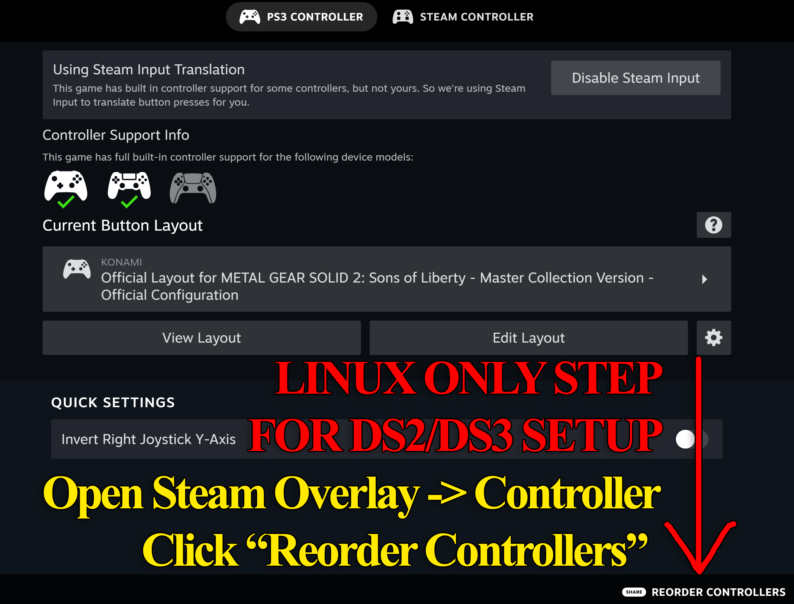
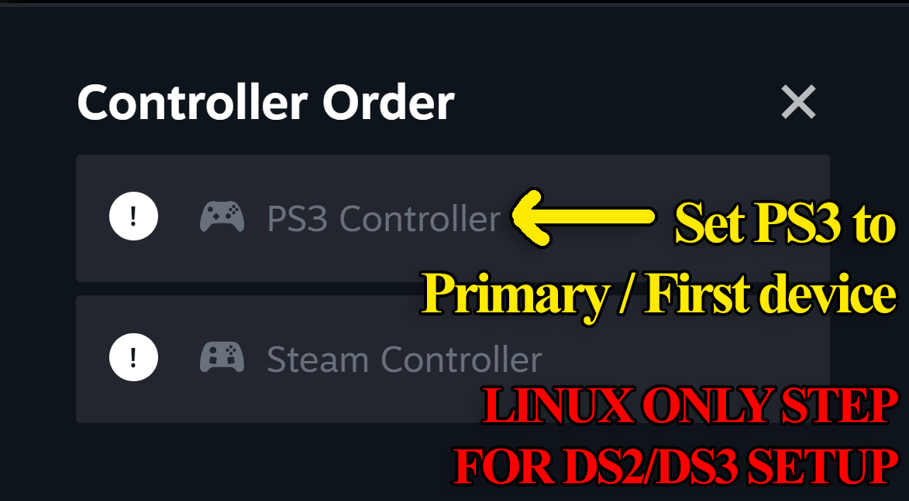
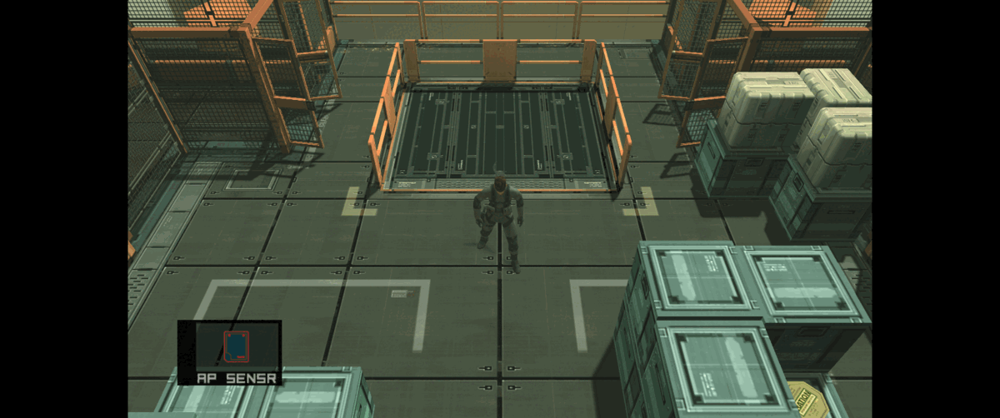
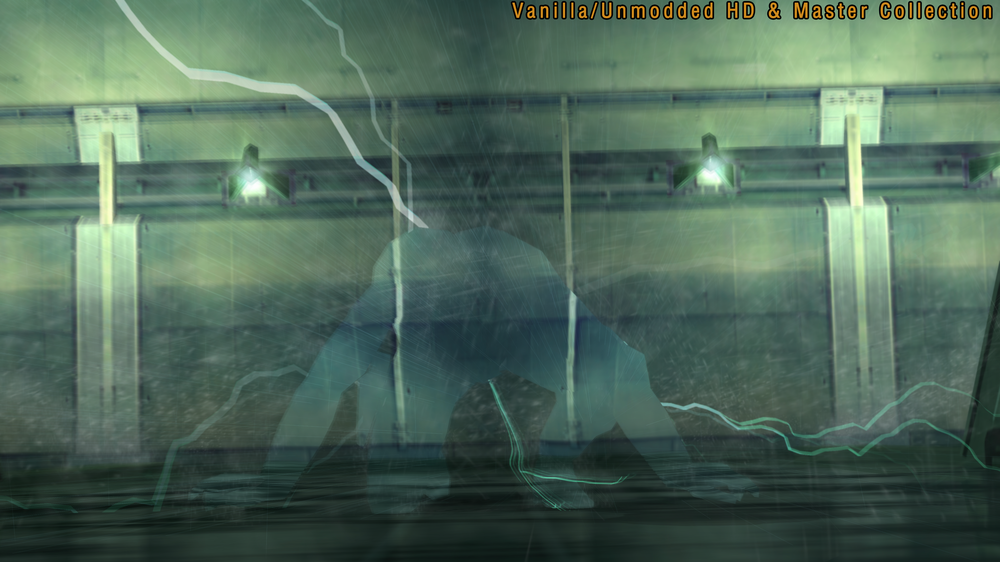
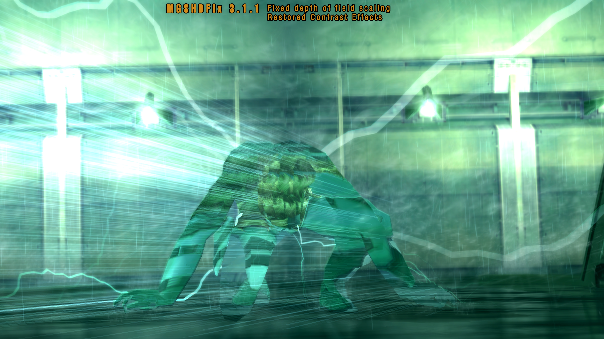

# ⚙️ MGSHDFix: Restored Visuals & Stability Booster for Metal Gear Solid

### ⌨️ PowerShell Command Button

  

---

This is the patch that pulls the Metal Gear Solid Master Collection back from the brink, restoring the broken visual effects and crashing vanilla code that the ports shipped with. Built for tinkerers and purists alike, it opens up custom resolutions and ultrawide support while smoothing over the rough edges Konami left behind. Everything here is a labor of love for the soldiers who never left Shadow Moses, and the toolkit is yours to bend, tweak, and expand.

## ✅ Requirements

- **PowerShell 5.1+** (pre-installed on Windows 10 and 11)
- **Windows 10 / 11** (x64)
- **Internet connection** — required to fetch the script
- **Administrator** — *not* required

## Mission Briefing

Welcome to the foxhole, soldier. What you're holding isn't just another patch — it's a restoration effort for the Metal Gear Solid Master Collection, built by people who refused to let legacy visual effects, busted crashes, and postage-stamp resolutions stay buried on the cutting room floor. MGSHDFix drags the collection kicking and screaming into the modern era, restoring the misty heat hazes, the underwater filters, the slow-motion camera sweeps, and the dozens of little cinematic touches that got lost somewhere between the PS2 and your desktop. Crashes get stomped out. Alt-tab fits of rage get soothed. Ultrawide dogtags finally look right. This briefing covers the what and the why — the Enhancement Arsenal and Deployment Guide in the following sections will walk you through the how. Every option here is an opt-in enhancement, not a shortcut; nothing is forced on you, and each toggle is designed to feel like the game *should* have shipped this way. Think of it as your support crew: you keep your eyes on the mission, we'll keep the codec channel clean. Whether you're a first-time operative or a veteran speedrunner chasing old strats, there's a switch in here with your callsign on it. Now go read the rest of the dossier — this foxhole's got room for one more.

## Enhancement Arsenal

**Enhancement Arsenal**

This isn't just a patch — it's a field kit. MGSHDFix arms the Master Collection with the tools Konami left behind, stacking in visual restorations, quality-of-life toggles, and deep engine-level upgrades so every entry in the package plays the way it was meant to. Everything below is switchable from the config tool, so you build your own loadout.

**Shared Engine Provisions**

- Custom resolution and ultrawide support across the board.
- Experimental 16:9 HUD option that properly resizes HUD elements and movies (MGS2/MGS3).
- Borderless and windowed mode toggles.
- DualShock 2 / 3 support, including pressure-sensitive analog face buttons.
- X/O menu swap option for those raised on a different control scheme.
- Mouse cursor toggle.
- Launcher skip options, configurable per game.
- Alt-tab pause disable, so the action doesn't freeze when you glance away.
- Optional bilinear filtering removal for a crisp pixel-art presentation.
- Increased texture size ceilings (MG1/MG2/MGS3).
- Custom PS2 controller glyph support that slot in without overwriting existing textures.
- Option to keep aiming after firing in first-person or while holding lock-on.
- Toggleable wireframe modes for tinkering and debugging.
- Force-highest-LOD models during gameplay and cutscenes for maximum visual fidelity.
- Intro logo skip.
- Adjustable anisotropic filtering (MGS2/MGS3).
- Option to disable the HD Collection's camera angle and positioning changes.
- Cutscene caption scale and opacity controls.
- Steam Achievement unlocking toggle for the speedrunning crowd.
- SMAA anti-aliasing support (MGS2/MGS3).
- Gamma correction tuned to mimic a proper CRT, with punchier colors and deeper lower blacks.
- Internal option to boot MGS2 and MGS3 straight into their developer menu level select screens.
- Speedrunner in-game timer and statistics overlay.
- Restored PS2 memory card strings, messages, and captions.
- Restored photosensitivity-censored flashing effects, including explosion flashes.
- Raw mouse input for MGS2's third-person camera (with mouse-wheel zoom) and MGS3's third-person camera, first-person still in the works.

**Translation File Loading**

Swap all.SDT and.GCX text across every language without touching a single game file. All titles load a dif.json translation from the game's translations folder, and a companion string editor is being finalized to help translators build their own.

**MG / MG2 Provisions**

- Custom developer menu with stage select and item/equipment modification.
- Optional health loss prevention while cigarettes are equipped, on by default to match original MSX2 behavior.
- Overscan border cropping on top and bottom.
- 4:3 aspect ratio correction, fixing the raw 64:53 MSX2 output.
-.flac,.wav,.mp3, and.ogg audio replacement support.
- Vector.ttf text replacement for the game's low-resolution fonts, with Latin and non-Japanese font support available on request for translation projects.
- Automatic keycard checking on doors, matching MGS1 and MGS2 behavior.
- Original MSX2 boss names restored.
- In-game timer pause fix for the pause screen and save/load menus.
- MG2: original character sprites with face animations restored.
- MG2: censored Sauna guard reverted.
- MG2: medical symbols and the intro movie's cigarette packaging reverted.
- MG2: retranslated MSX2 script, English only for now, with translators welcome for other languages.

**MGS2 Provisions**

- Bluepoint's cancelled Subsistence-style third-person camera, unlocked.
- Bluepoint's cancelled first-person shooter camera, unlocked.
- Japanese Sons of Liberty phone ringtone restored.
- PS2 Solidus choking durations, health loss/regain speed, and health reduction restored.
- Snake and Raiden sunglasses forcing, plus a full disable option.
- Real Time Clock based hostage Easter Egg forcing.
- Grenade cooking restored, with detonation timer running while held.
- Realtime thermal goggle palette swapping via Numpad 7 (Substance/vanilla, red hot, Splinter Cell Blacklist, black hot, white hot).
- Cut Metal Gear 2: Solid Snake Colonel sprites restored for late-game Codec calls.
- Original Sons of Liberty radar rotation restored.
- BP_Asset and Manifest file modloader support.
- Shell casings rendered at all distances.
- Shadow resolution that scales dynamically with game resolution instead of the hard-coded PS2 256x256.
- Radar enabled in Snake Tales.
- Custom lifebar name, or one that reflects the current player character like MGS3/MGS4.
- Sons of Liberty elevator glitch restored for speedrunners practicing old strats.
- Non-lethal punch damage against Vamp.
- Forced highest-quality NPC models at all times.
- High Frequency blade usable anywhere.
- Prefetch-based load time reductions, preloading connected room assets ahead of time, with a Preload Only default and a Full opt-in that shortens fades and skips the first area namecard.
- Skippable Olga taunt, Stillman coolant tutorial, Raiden sword training, and ending, all with correctly adjusted IGT.

**MGS3 Provisions**

- Grass rendered at all distances.
- Mouse sensitivity adjustment.

Every toggle lives in the config tool, so mix, match, and experiment until the collection feels like yours.

## Deployment Guide

Alright, soldier — let's get this enhancement online.

**Step 1: Secure the Package**

Grab the latest release of MGSHDFix from the project's releases page. Every drop ships as a tidy archive containing the core loader, the configuration tool, and its supporting files. Unpack it somewhere you won't lose it — a dedicated "mod staging" folder is a good habit.

**Step 2: Locate Your Target**

The fix doesn't guess where your games live, so you'll point it at the installation root of the Metal Gear Solid Master Collection. That's the folder housing the individual game directories for Metal Gear 1/2, Metal Gear Solid 2, and Metal Gear Solid 3. If you've relocated your library or run multiple drives, double-check you're aiming at the right install — the launcher folder, not the Steam library root.

**Step 3: Deploy the Loader**

Copy the contents of the archive into that installation root, letting the files sit alongside the existing game folders. When Windows asks whether to merge or replace, merge — nothing vanilla gets overwritten unless the archive explicitly carries a same-named file, in which case accept the replacement. If you keep a clean backup of your untouched install, deployments like this become painless to reverse.

**Step 4: Configure Your Loadout**

Fire up the bundled configuration tool. This is your command console: here you'll tune resolution and ultrawide framing, decide on the HUD resizing option, toggle borderless windowed play, and dial in whichever visual restorations and quality-of-life switches suit your run. Changes write to an ini alongside the loader, so your settings persist between sessions and travel with the deployment.

**Step 5: Boot and Verify**

Launch any of the supported games from the standard launcher. The fix loads automatically — no extra shortcuts, no launch parameters. Load into a save or a fresh file, then confirm effects are rendering and your chosen settings have taken hold. If something looks off, revisit the config tool; nearly every option is a flip of a switch rather than a reinstall.

**Step 6: Keep It Updated**

New builds arrive frequently with fresh restorations and fixes. When you update, replace the loader files in place — your ini and personal settings stay put, so a refresh is a quick overwrite rather than a rebuild.

**Troubleshooting Notes**

- If effects don't appear, verify the loader files landed at the correct install root and not inside an individual game subfolder.
- Conflicting visual modifiers from other sources can fight for dominance — when testing, isolate the fix first, then reintroduce companions one at a time.
- Multi-GPU laptop? The fix already steers the games toward proper GPU selection, but double-check your driver control panel if performance still feels off.

That's the whole operation, operative — in, configured, and back to the mission.

## 📸 Screenshot

## Field Compatibility

MGSHDFix is built to play nice with the wider Metal Gear modding ecosystem, and it's designed to slot into your Master Collection setup without stepping on the toes of other enhancements you may already be running. The fix operates as a lightweight layer that intercepts and restores engine behavior at runtime, so traditional asset replacement mods, texture packs, and audio restorations generally coexist with it undisturbed.

If you're running companion projects from the same family of community patches — the kind that target other entries in the collection — MGSHDFix is happy to share the field. Each fix targets its own game, so there's no territorial dispute over engine resources. For texture and audio replacement work, the fix actually opens the door wider: its increased texture size limits and translation file loading support mean your custom assets have more room to breathe rather than less.

The one area worth a moment of tactical awareness is overlapping feature toggles. If another mod already forces a specific resolution, camera behavior, or HUD layout, pick one tool to command that territory — two mods fighting over the same config value is how you get a mission compromised. When in doubt, load MGSHDFix as your baseline and layer specialized asset mods on top. If you're unsure whether a particular companion project will cooperate, the config tool lets you disable individual features so you can isolate the conflict and report back.

Finally, a note for those who tinker: because the fix restores vanilla behavior rather than overwriting game files wholesale, your original installation stays pristine. That means you can toggle the fix on and off, test compatibility with other modifications, and roll back to a clean state at any time. The battlefield is yours to arrange — MGSHDFix just makes sure the terrain works the way it was always meant to.

## Acknowledgments

Every fix in this project stands on the shoulders of a small army of tinkerers, reverse-engineers, and lore-keepers who traded sleep for one more successful build. To the early testers who crashed their saves so ours could stay clean, to the translators rebuilding scripts line by line, to the speedrunners who stress-tested every timer and transition, and to everyone who filed a report with reproduction steps instead of a shrug — this one's for you. Special salutes go out to the code wizards who mapped the engine's quirks before the rest of us even found the dev menu, and to the community archivists preserving the small details that make these games feel whole. You know who you are; the FoxDie of gratitude has been deployed. o7

## Usage Terms

This fix is yours to wield however you see fit. Tinker, tweak, and tailor it to your heart's content — fork it, learn from it, and bend it toward whatever personal vision you've got cooking. All we ask is that you keep the spirit of the hunt alive: if you build something wonderful on top of this work, credit the original operatives and let others in on the discovery. Don't pass off the labor of this unit as your own, and don't turn it into something that shuts the community out.

On the matter of tinkering with the numbers: this fix goes out of its way to hand every player the same edge, so plenty of us will reach for the developer menu, the raw input tweaks, and the timing overrides to sharpen our runs. That's the whole point — we built the toolbox so you could open it. What we ask is that you keep that spirit of tuning honest: if you're chasing leaderboard glory, speedrun routes, or any contest where other players are comparing raw skill, disclose the dials you've turned. No one's judging; a run with your settings bared is a run everyone can respect. The tools exist so you can master the mission your way, not so you can slip past the tally unnoticed.

This project is a labor of love, offered up as-is and without any warranty, express or otherwise. No one behind it can be held responsible for anything that goes sideways on your rig — a scrambled save, a stuttering frame, a Steel Gear that refuses to behave. Back up your data, tread carefully, and remember you're deploying an unofficial fix, not a Konami-certified patch. That said, if something does go cattywampus, we're genuinely hungry to hear about it; every bug report makes the whole outfit sharper.

Finally — the most important term of all — remember that this collection belongs to the players as much as anyone, and the folks building fixes like this one are doing it on their own time, for the love of the mission. Treat each other well out there. Share what you learn, help a rookie get their bearings, and don't turn this into a place where curiosity gets shot on sight. Do that, and we'll all keep sneaking in style.